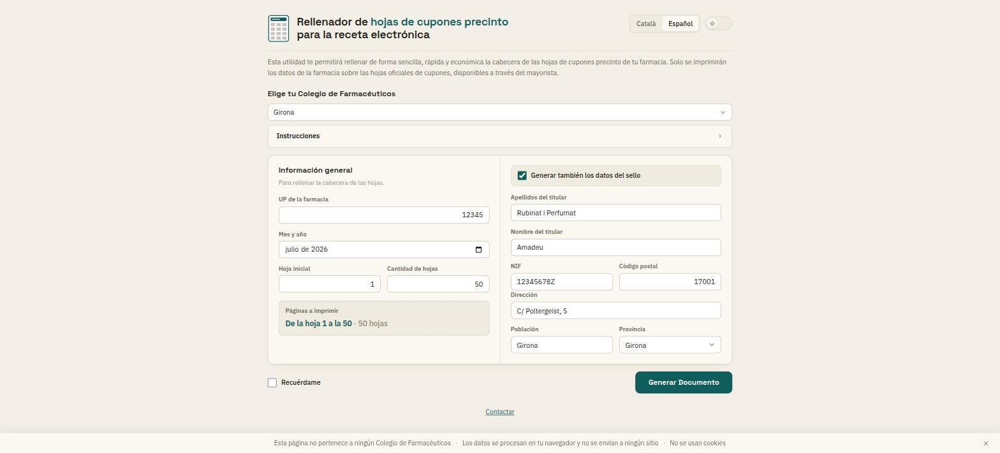

# FarmaKit

<p align="center">
  
</p>

**Fills in the header of Spanish pharmacy coupon sheets** (*fulls de cupons precinte* /
*hojas de cupones precinto*) for the electronic prescription system. You print the output
*on top of* the official sheets supplied by the wholesaler — FarmaKit prints only the
pharmacy's data, never the sheet itself. It replaces filling those headers by hand, in the
browser, with your data kept local.

**→ [nuncaeslupus.github.io/farma-kit](https://nuncaeslupus.github.io/farma-kit/)**

## Quick start

Open the [web app](https://nuncaeslupus.github.io/farma-kit/), or run it locally:

```bash
npm install
npm run dev        # dev server → localhost:5173/farma-kit/
```

Pick your *col·legi*, fill in the pharmacy's data, press **Generar Documento**, and print
the PDF onto the official sheets.

## Example



The form on the left produces the header overlay on the right. The app prints only the
pharmacy's data, aligned to the official sheet layout — you feed the real coupon sheets
into the printer and the header lands in the right boxes.

## How it works

1. **Pick your *col·legi de farmacèutics*.** That choice drives the rest of the form — it
   sets the sheet layout, the National Code, and whether the stamp section applies.
2. **Fill in the pharmacy's data.** Tick *Recuérdame* and the browser keeps it for next
   time (in `localStorage`, never uploaded).
3. **Generar Documento** → a PDF generated locally with [pdf-lib](https://pdf-lib.js.org/),
   ready to print onto the official sheets.

All provincial *colegios* are listed, grouped by autonomous community. A sheet layout has
to be traced from a real printed sheet, so a *col·legi* with no template yet is shown but
not selectable — the app offers to request it instead. Currently the Catalan *col·legis*
(Barcelona, Girona, Lleida, Tarragona) are available.

Available in Catalan, Spanish, Basque and Galician.

## Privacy

Everything runs in your browser. The pharmacy data you type is never uploaded: the PDF is
generated locally. There is no backend, no analytics, and no cookies.

## Documentation

Maintainer documentation — architecture, how to add a *col·legi*, the template editor,
gotchas and current status — lives in **[`status/handoff.md`](status/handoff.md)**.

## Development

```bash
npm install
npm run dev        # dev server → localhost:5173/farma-kit/
npm test           # Vitest, once
npm run build      # typecheck + production build → dist/
```

Vite + Lit + TypeScript, no backend. Pushes to `main` deploy automatically via GitHub
Actions.

## Related projects

- [claude-arsenal](https://github.com/nuncaeslupus/claude-arsenal) — spec-driven Claude Code workflow and gated task queue.
- [drawspec](https://github.com/nuncaeslupus/drawspec) — declarative diagram spec → clean SVG/PNG/text, writable by LLMs; MCP server included.
- [doc-control](https://github.com/nuncaeslupus/doc-control) — lets AI agents edit Word documents as tracked changes.
- [literary-critic](https://github.com/nuncaeslupus/literary-critic) — LLM manuscript analysis the way a professional editor would.
- [integral-job-search](https://github.com/nuncaeslupus/integral-job-search) — candidate-centred job search run in Claude Code.

## License

MIT — see [LICENSE](LICENSE).
